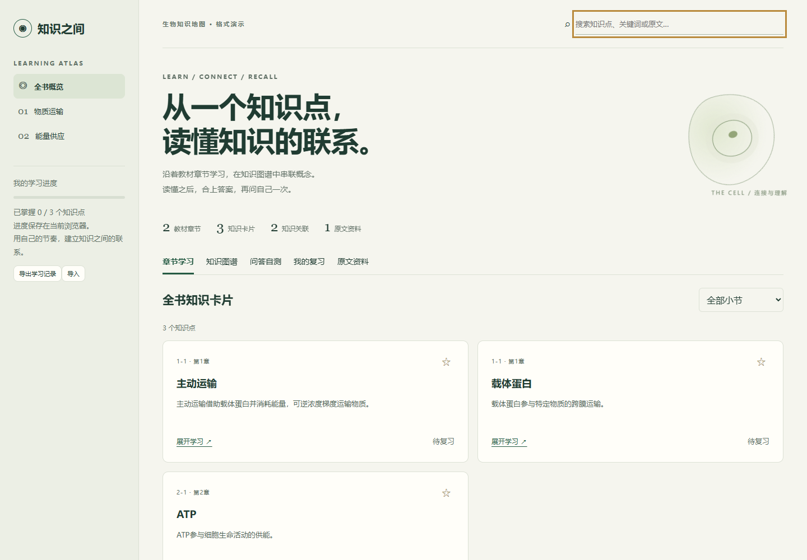
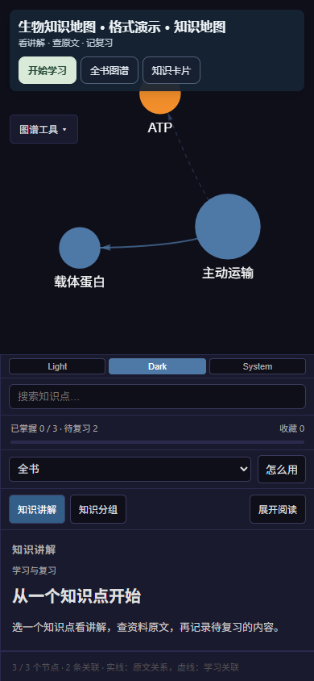

# 通用资料知识库制作 Skill

把微信聊天记录、课程笔记、考公或考研资料，整理成能点开主题、回查原文的离线知识库。学习资料提供自测与复习；聊天资料保留发言人、时间和讨论上下文。

提炼自 [etasp](https://github.com/etasp) 的真实资料整理项目。生物必修1是最早的学习案例，处理过56份资料、165张知识卡；这些数字和学科不限制新项目。仓库与调用标识 `bio-knowledge-map` 保留以兼容已有链接和安装。此仓库不附原课件、私人聊天记录、个人数据或密钥。

## 适用场景

| 输入 | 如何组织 | 输出侧重 |
| --- | --- | --- |
| 微信聊天记录 | 按讨论串、主题、发言人及时间 | 主题卡、观点与结论、资源、待跟进、消息回查 |
| 考公资料 | 按所给考试类别、地区、年份及大纲模块 | 考点、题型、方法、错题与复习 |
| 考研资料 | 按所给科目、院校专业、年份及参考资料 | 概念联系、解题方法、自测与复习 |
| 大学课程/其他学科 | 按实际课程章节或主题 | 知识卡、关系图、原文、自测 |

聊天导入见 [references/chat.md](references/chat.md)。当前工具接收已导出的聊天文件，不包含微信数据库采集器。图片、语音和附件没有实际识别时，仅保留记录，不编造内容。

## 小样例预览

以下截图来自仓库内独立编写的3卡演示，展示实际离线运行结果。





## 在 Codex 中使用

将本仓库放到 `~/.codex/skills/bio-knowledge-map`，或将仓库内容复制到该目录。

```text
用 $bio-knowledge-map 把这个文件夹里的课程或备考资料做成学习知识库。
保留知识点之间的关联、原文出处、自测和待复习功能。
```

也可以直接说：

```text
用 $bio-knowledge-map 整理这份微信群聊天记录，按主题归纳观点和待跟进事项，并能回查消息。
用 $bio-knowledge-map 按这份大纲整理考公资料，做成考点地图和自测复习库。
用 $bio-knowledge-map 把我的考研专业课资料做成知识库，保留章节和原文出处。
```

其他支持 SKILL.md 的 agent 可将目录装到其 skills 路径。完整流程在 [SKILL.md](SKILL.md)，数据字段在 [references/schema.md](references/schema.md)。

## 包含什么

- SHA-256资料去重，同名不同内容保留；Office只读文字提取与页码保留。
- 可编辑的 knowledge.json，以及证据、来源和关系端点校验。
- 复用原项目的交互图谱、知识卡、章节搜索、原文回查、先答后翻、自行标记复习和记录导入导出。
- 桌面/手机布局与离线浏览器验收脚本。

它是给 agent 的制作流程与工具，不是将任意课件自动变成可靠知识的黑盒。知识卡需要 agent 通读资料、整理并核对；图示与复杂公式可能需要额外视觉核查。默认基础工具离线可用，AI问答为按需实现的扩展，当前生成器不包含问答服务。

## 跑通小样例

以下命令在仓库根目录运行，需要 Python 3.10+。构建依赖 Graphify 固定版本。

```bash
python -m pip install -r requirements.txt
python scripts/test_pipeline.py
python scripts/build.py assets/demo/knowledge.json --project assets/demo --output output/demo
```

聊天模式的虚构小样例（无需自测题）：

```bash
python scripts/build.py assets/chat-demo/knowledge.json --project assets/chat-demo --output output/chat-demo
```

打开 `output/demo/开始学习.html`。示例是独立编写的3张卡片和2条关系，仅演示格式，不是完整教材，也不是原项目165卡的复制。

浏览器检查：

```bash
python -m pip install playwright
python -m playwright install chromium
python scripts/check_site.py output/demo/开始学习.html
```

Office提取需要 Windows 和 Microsoft Word/PowerPoint；PDF和扫描图片的处理方式及AI问答扩展边界见 [references/pipeline.md](references/pipeline.md)。示例不需要 Office 或模型 API Key。

## 用自己的资料

```bash
python scripts/intake.py path/to/资料.zip --output output/my-course
```

Windows Office环境：

```powershell
pwsh -File scripts/extract-office.ps1 -ProjectRoot output/my-course
```

让 agent 按 SKILL.md 对照 corpus 与原附件整理 knowledge.json，再构建到新的交付目录。不要仅凭清单数量或提取成功就认定所有内容已覆盖。

学习记录仅保存在当前浏览器。迁移文件、换浏览器或改用HTTP服务时，先导出记录再导入。公开分享自己生成的完整包前，请确认其中资料适合分享。

本仓库原创流程与改编工具采用 MIT 许可。Graphify、vis-network 及其内含依赖保留各自许可，见 [THIRD_PARTY_NOTICES.md](THIRD_PARTY_NOTICES.md)。
